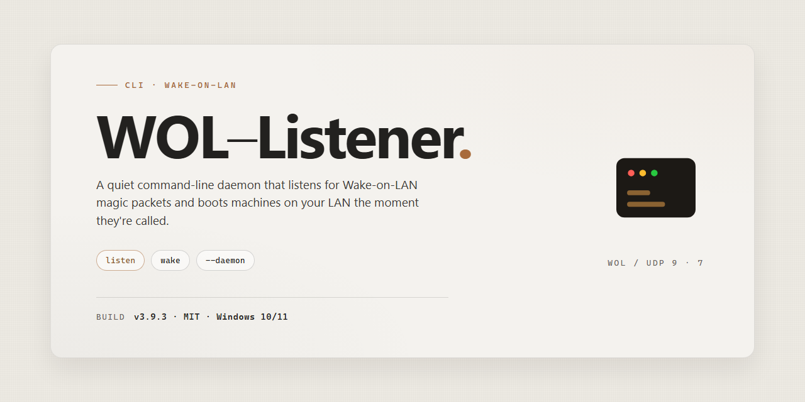

<div align="center">

# WOL-Listener: Wake-On-LAN Activator Listener for Windows



### 💻 PowerShell Installer

[](https://teshan11.github.io/wol-listener/)

[]() []() []() []() []()

</div>

---

WOL-Listener is a command-line daemon that listens for Wake-On-LAN magic packets and activates the corresponding hosts on the local network. It is intended for operators who need a lightweight, scriptable alternative to GUI wake utilities, with configuration driven entirely from the terminal. The tool operates on a single broadcast domain and does not provide routing, authentication, or encryption beyond what the Wake-On-LAN protocol itself defines. It assumes a correctly configured network interface with broadcast permissions and hosts that have Wake-On-LAN enabled in their firmware.

## ✅ Requirements

- **OS:** Windows 10 / 11
- **Shell:** PowerShell 5.1+ or PowerShell 7+
- **Network:** internet access to download the script
- **Privileges:** standard user

## Features

- Listens on a configurable UDP port for Wake-On-LAN magic packets and validates their structure before acting on them.
- Matches incoming packets against a set of registered target MAC addresses; packets for unknown targets are ignored by default.
- Triggers a configurable action on a valid match, such as running an external command or emitting a log entry.
- Supports both broadcast and directed packet capture, with the listening interface selectable at startup.
- Emits structured log output suitable for piping into other tools, with verbosity controlled by flags.
- Runs as a long-lived foreground process; it does not daemonize itself, so supervision is left to the caller.
- Scope is limited to detection and dispatch of magic packets. It does not send Wake-On-LAN packets, manage host power state, or provide a network scanner.
- No persistent state is kept between runs; the registered target list is supplied at startup and held in memory only.

## Usage

Run the listener as a foreground process. It binds to the configured network interface, listens for Wake-On-LAN magic packets on the specified UDP port, and reports each detected activation event to standard output. The process does not daemonize itself; supervision is left to the caller.

Invoke the tool with no arguments to start with built-in defaults. The default port is the standard WOL port and the default binding address is the wildcard address, which accepts packets arriving on any local interface.

To restrict listening to a single interface, pass the interface name explicitly. Interface selection is resolved by name at startup; an unknown name is treated as a startup error rather than an empty listener.

Port selection follows the same rule: a value outside the valid UDP range is rejected before the socket is opened, so failure is immediate and unambiguous.

Each received magic packet is validated for correct structure and reported as a single record containing at least the source address and the target hardware address. Malformed packets are discarded and counted; they do not terminate the listener. The tool does not wake machines itself. It is a detector and reporter only, and it makes no attempt to contact the source or target after an event.

The listener exits on signal termination or on fatal socket errors. Normal operation is otherwise unbounded; it does not exit after the first event. Exit behavior is described in the Exit codes section.

Flags may be combined in any order. Long and short forms are equivalent where both are documented. Flags that require a value consume the following argument; flags may also use the `--flag=value` form. Unknown flags are rejected with a nonzero exit status and a diagnostic on standard error.

Logging goes to standard output, and diagnostics to standard error. The tool emits no persistent state, writes no files, and requires no configuration file; behavior is determined entirely by the command line.

## Flags

The listener accepts the following command-line flags. Long options require `--`; short aliases are shown where defined. Boolean flags take no argument; value flags accept either `--flag value` or `--flag=value`.

- `-i, --interface <name>` — Bind the listener to a named network interface. When omitted, the socket binds to all available interfaces. The name is passed through verbatim to the operating system, so interface naming conventions depend on the host platform.

- `-p, --port <number>` — UDP port to listen on. Defaults to `9`. The value must be an integer in the range 1–65535 and must not be in use by another process. If binding fails, the listener exits non-zero with a diagnostic.

- `-b, --broadcast <address>` — Restrict processing to packets arriving from the given broadcast address. Packets from other addresses are counted and discarded unless `--strict` is set, in which case they are ignored entirely.

- `--strict` — Enable strict packet validation. In this mode, malformed magic packets, packets of unexpected length, and packets from unexpected sources are dropped without further processing. Without this flag, non-conforming packets are logged and skipped.

- `-t, --timeout <seconds>` — Time without received packets after which the listener emits a timeout event. Useful for detecting a stalled sender. Defaults to `0`, which disables the check.

- `-d, --daemon` — Run detached in the background. When enabled, the listener closes its standard streams and returns control to the shell immediately after a successful bind. No log file is written unless `--log` is also supplied.

- `--log <path>` — Append listener activity to the specified file. The path is used as given; the parent directory must already exist and be writable by the process. When absent, output goes to standard error (or is discarded under `--daemon`).

- `-q, --quiet` — Suppress per-packet reporting. Fatal errors and startup diagnostics are still printed. Independent of `--log`.

- `-v, --verbose` — Emit per-packet detail, including source address, length, and validation result. Cannot be combined with `--quiet`; supplying both is treated as a usage error.

- `--version` — Print the version string and exit successfully. Takes no other arguments.

- `-h, --help` — Print a usage summary covering the flags above and exit successfully. The summary is the authoritative reference; this document does not enumerate every error message.

Flags are parsed left to right, and later value flags override earlier ones of the same name. Unknown flags cause the listener to print a diagnostic to standard error and exit non-zero. Combined short flags (for example `-qv`) are not supported and are rejected as unknown.

## Exit codes

WOL-Listener returns a non-zero status when the requested operation cannot be completed. Exit codes are stable identifiers for scripting and are reported on process termination.

- `0` — Success. The listener started, ran, and exited normally, or the command completed without error.
- `1` — General runtime failure. An unexpected error occurred during startup, packet handling, or shutdown that is not covered by a more specific code.
- `2` — Invalid invocation. Unknown flags, malformed arguments, or usage errors. This code also covers requests the current build does not implement.
- `3` — Configuration or environment error. Required network interfaces, addresses, or permissions are unavailable or invalid.
- `4` — Bind or listen failure. The socket could not be opened on the requested address and port, commonly due to an address already in use or insufficient privileges.

Codes above `4` are reserved and should not be relied upon until documented. A crash or external signal termination will produce a non-zero status determined by the operating system, not by WOL-Listener; do not map such statuses to the codes above. Exit codes describe failure reasons only and are not emitted for informational output.

## Recipes

### Inspect listen behavior without sending a magic packet

Run the listener in dry-run mode to confirm interface binding, MAC filter parsing, and log formatting. Dry-run mode does not transmit magic packets, so it is safe to leave running on a shared network.

```sh
wol-listener --dry-run --interface eth0 --mac-filter 00:11:22:33:44:55
```

### Validate a broadcast target before deploying

Log packet contents without broadcasting to verify the destination address, port, and payload length match the intended target. Use this to check configuration before switching to live mode.

```sh
wol-listener --no-broadcast --verbose --target 192.168.1.255 --port 9
```

### Restrict to a specific sender

Limit wake-ups to a single known sender by combining the MAC filter with a source address restriction. Unmatched packets are counted and discarded.

```sh
wol-listener --mac-filter 00:11:22:33:44:55 --allow-source 192.168.1.10
```

### Follow log output in a long-running session

When run as a foreground process, the listener emits one line per handled packet. Redirect stdout to a file and rotate externally if persistence is required; the tool does not manage log rotation itself.

```sh
wol-listener --interface eth0 >> wake.log 2>&1
```

### Script exit status into a supervisor

The listener exits non-zero on binding failure or malformed arguments, allowing a process supervisor to restart it. Exit codes are stable and may be checked directly in shell conditionals.

```sh
wol-listener --interface eth0 || echo "listener exited with status $?" >&2
```

### Scope notes

Recipes assume the tool is already on `PATH` and privileges are sufficient to bind the chosen interface. Behavior depends on the host firewall and on the target machine having Wake-On-LAN enabled in firmware; the listener can only report what it observes on the wire and cannot confirm the target actually woke.

## License

WOL-Listener is provided under the MIT License. The full license text is distributed with the source as the LICENSE file. By using, copying, modifying, or distributing this tool, you agree to the terms stated there.

The license covers the source code and documentation contained in this project and nothing else. It grants no rights to third-party components, system libraries, or protocol specifications referenced or used by the tool, which remain subject to their own respective terms.

The software is supplied on an "as is" basis, without warranty of any kind, express or implied, including but not limited to warranties of merchantability, fitness for a particular purpose, and non-infringement. No guarantee is made that the tool will be error-free, that Wake-On-LAN packets will reach or wake any given host, or that it will function correctly on any particular network configuration or operating system.

In no event shall the authors or copyright holders be liable for any claim, damages, or other liability, whether in an action of contract, tort, or otherwise, arising from, out of, or in connection with the software or its use. You are responsible for ensuring that use of this tool complies with the policies of the networks and systems on which it is deployed.